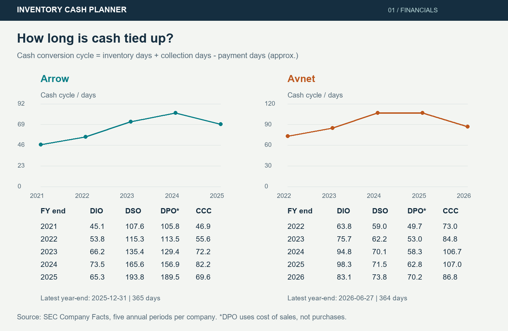
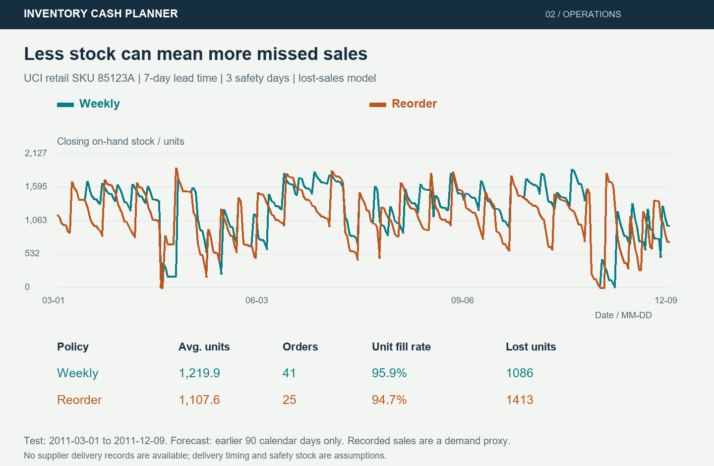
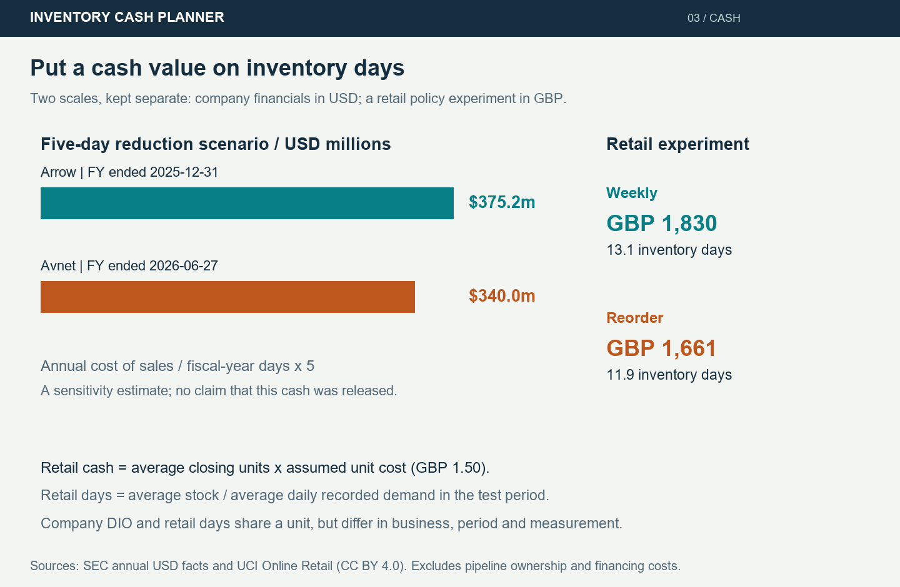

Inventory Cash Planner — connect ordering decisions, inventory days, and cash tied up.

Replay public retail sales under two ordering policies, then compare the result with five years of working-capital ratios for Arrow Electronics and Avnet. Everything needed for the example is bundled. Running the tool and tests needs no network after installing dependencies.

## Why it matters

A buyer can reduce stock and still make a worse decision if too many sales go unfilled. A finance analyst needs to know how much money those inventory days represent. This project puts both questions in one report, with the assumptions and original filing facts visible.

**Default experiment:** weekly ordering holds about GBP 1,830 in average on-hand inventory and serves 95.9% of recorded units. Reorder-point ordering holds about GBP 1,661 and serves 94.7%. These are simulated results for one gift product, not observed supplier performance.

## Quick start

Use Python 3.12. Create an environment and install two dependencies: Pillow for charts and openpyxl for rebuilding the retail sample.

```sh
python -m venv .venv
```

Activate it on Windows PowerShell:

```powershell
.venv\Scripts\Activate.ps1
```

Or on macOS/Linux:

```sh
source .venv/bin/activate
```

```sh
python -m pip install -r requirements.txt
python -m unittest discover -v
python -m cash_planner
```

Open `output/report.html` in a browser. It contains embedded charts and a JavaScript inventory-day scenario calculator; no server, CDN or API connection is needed. The CLI also writes `results.json`, `financials.csv` and `policy-daily.csv` beside the report.

A generated example is already in [docs/report.html](docs/report.html); download or open the file locally to use its controls. Its companion [financial CSV](docs/financials.csv) and [policy daily CSV](docs/policy-daily.csv) make the calculations inspectable.

```sh
python -m cash_planner --lead-days 14 --safety-days 5 --unit-cost 2.00 --output output/scenario.html
python -m cash_planner --showcase docs/showcase
python -m cash_planner --help
```

### Automated runners and Windows launch errors

From the project folder, with dependencies installed in the Python environment used by the runner, use these single commands:

```sh
python -m unittest discover -v
python -m cash_planner --showcase docs/showcase
```

Both commands were verified with Python 3.12 on Windows. `WinError 2` when launching a command means the runner could not find the executable; check its Python path before changing application code. Virtual environments use different paths on each operating system. On Windows, run the environment's Python directly without activation:

```powershell
.\.venv\Scripts\python.exe -m unittest discover -v
.\.venv\Scripts\python.exe -m cash_planner --showcase docs/showcase
```

On macOS/Linux the equivalent executable is `.venv/bin/python`. Create the environment locally using the quick start above; virtual environments are gitignored and must not be copied between operating systems.

`--lead-days` is an integer of at least one calendar day; `--safety-days` is a nonnegative number of days of forecast demand; `--unit-cost` is a positive assumed GBP cost per unit. The retail selling price is not used as cost. Rebuild with the CLI to change policy assumptions; the report's browser control changes only the company cash-release scenario.

## Example output

```text
Arrow FY 2025-12-31: CCC 69.6 days; five-day inventory scenario USD 375.2m
Avnet FY 2026-06-27: CCC 86.8 days; five-day inventory scenario USD 340.0m
Weekly: avg 1219.9 units; 41 orders; fill 95.9%; cash GBP 1,829.80; 13.1 inventory days
Reorder: avg 1107.6 units; 25 orders; fill 94.7%; cash GBP 1,661.33; 11.9 inventory days
```

## Showcase

Regenerate all three 1440 × 940 PNGs offline with `python -m cash_planner --showcase docs/showcase`.



Five annual periods show how inventory, collections and supplier payments combine into each distributor's cash cycle.



The same recorded sales reveal the stock and simulated service trade-off between weekly and reorder-point ordering.



A five-day company scenario and a separate retail cost assumption put inventory days into money terms.

## How it works

### Financial ratios

The bundled SEC snapshot was retrieved November 16, 2026 Pacific time (November 17 UTC). It includes Arrow FY2021–2025 and Avnet FY2022–2026, the latest five complete annual periods available for each company. Fiscal calendars differ; the report always shows the year-end date. These are not five matched calendar years.

`finance.py` selects annual USD facts from 10-K and 10-K/A forms. It matches actual start/end dates, not the fiscal year assigned to a later filing containing a comparative figure. It uses these explicit concept families:

- Revenue: `RevenueFromContractWithCustomerExcludingAssessedTax`, `Revenues`, then `SalesRevenueNet` for equal-date alternatives.
- Cost of sales: `CostOfRevenue`, then `CostOfGoodsAndServicesSold`.
- Balances: `InventoryNet`, `AccountsReceivableNetCurrent`, `AccountsPayableCurrent`.

Within an exact period the latest filing date wins, then the listed tag preference and accession order resolve ties. Duplicate identical records are harmless; conflicting values with identical provenance are rejected. Comparative facts from later filings may restate earlier values. Mixed filing accessions are flagged for review. This is an explicit mapping for these two issuers, not a universal XBRL accounting engine.

Opening balances must fall exactly one day before the annual start. Average balance means `(opening + closing) / 2`. Year length includes both start and end dates: 366 for Arrow 2024, and normally 364 for Avnet's 52-week year.

```text
DIO = average inventory / annual cost of sales × fiscal-year days
DSO = average net current receivables / annual revenue × fiscal-year days
DPO = average current accounts payable / annual cost of sales × fiscal-year days
CCC = DIO + DSO − DPO
Five-day cash scenario = annual cost of sales / fiscal-year days × 5
```

**DPO is an approximation:** cost of sales replaces purchases. Receivables may contain non-trade balances. Missing balances and nonpositive denominators remain unavailable, with flags. Every ratio retains the tags, USD values, filing dates, accession numbers and source periods in the report and JSON.

Arrow 2024 was independently checked against the annual filing's operations and balance-sheet tables. See [the reconciliation](docs/reconciliation.md); the test compares every input to a separate transcription and calculates the ratios again from the filing's thousands-of-dollars values.

### Ordering-policy replay

The small retail fixture contains **374 daily totals** for SKU `85123A`, WHITE HANGING HEART T-LIGHT HOLDER, December 1, 2010–December 9, 2011. It is derived from 2,265 positive, non-cancelled transaction rows with positive prices. Customer IDs, invoice IDs and country fields are omitted. Every calendar date is included; a day without a qualifying sale receives zero units. Recorded sales are a **demand proxy**, not complete demand.

The first 90 calendar days train a constant mean daily forecast. The remaining 284 days are replayed without refitting on test sales. Both policies start with the same assumed stock: forecast × (lead time + safety days), rounded up.

1. Receive orders due today, before demand.
2. Serve as much of today's recorded demand as possible; count the rest as lost sales.
3. Review inventory position: on-hand stock plus outstanding orders.
4. Weekly ordering reviews every seven days starting on test day one. Reorder-point ordering reviews daily when position is at or below forecast × (lead + safety).
5. Both order up to forecast × (lead + safety + seven days), rounded up. Orders arrive after the assumed lead time.

Using the same target keeps the comparison focused on review timing and the reorder threshold. The daily policy may place fewer, larger orders; its name does not imply that it orders daily.

Average inventory is the mean of daily closing on-hand units. Unit fill rate is units served divided by recorded units demanded. Retail inventory days divide average stock by mean daily test demand; cash tied up multiplies average stock by assumed GBP cost. No company USD values are added to retail GBP values. Corporate CCC also includes receivables and payables, so it is not a direct retail inventory target.

## Public sources and refresh

- [SEC Company Facts API](https://www.sec.gov/search-filings/edgar-application-programming-interfaces): keyless public consolidated filing facts for CIK 7536 and CIK 8858. The data manifest records source URLs, raw SHA-256 hashes and snapshot time.
- Chen, D. (2015). [Online Retail, UCI Machine Learning Repository](https://archive.ics.uci.edu/dataset/352/online-retail), [doi:10.24432/C5BW33](https://doi.org/10.24432/C5BW33). Licensed [CC BY 4.0](https://creativecommons.org/licenses/by/4.0/). Changes: filter one product, exclude cancellations/nonpositive sales, aggregate by date, add zero-sale dates and omit identifiers. This attribution applies to the bundled derived daily totals.

Downloads are separate from normal execution and tests. Supply a real project/organization name and contact URL or email in SEC's User-Agent header; no key or account is required:

```sh
python -m scripts.refresh_data --sec-user-agent "Your project name https://your-real-project-contact-url"
python -m cash_planner --output docs/report.html --showcase docs/showcase
python -m unittest discover -v
```

Requests are serial with at least 250 ms between attempts. Transient failures retry with backoff or the server's Retry-After seconds. A refusal such as HTTP 403 stops with a readable error and leaves the bundled sample intact. Raw JSON and the roughly 23 MB retail ZIP go under gitignored `data/raw/`; do not commit them. To rebuild an existing download without a network request, run `python -m scripts.refresh_data --from-cache`.

The manual **Refresh public sample** GitHub Actions workflow downloads and validates a new snapshot, then uploads it as a reviewable artifact. It never commits or publishes automatically. The ordinary CI workflow tests the bundled sample and regenerates the showcase. All intended repository files are under 5 MB; the bundled sample is under 1 MB.

## Tests and project layout

`python -m unittest discover -v` runs offline with the standard-library test runner. Tests cover duplicate/amended facts, missing openings, invalid denominators, independent annual-report reconciliation, daily inventory conservation, arrival timing, pipeline-aware ordering, forecast isolation, UCI filtering, mocked HTTP retries and report/image generation with network sockets blocked.

- `cash_planner/finance.py`: period matching, source receipts and ratios.
- `cash_planner/simulation.py`: deterministic ordering and lost-sales accounting.
- `cash_planner/data.py`: bundled input loading and train/test split.
- `cash_planner/charts.py`, `report.py`: PNG charts, offline HTML and CSV/JSON exports.
- `scripts/refresh_data.py`: optional public download and sample rebuilding.
- `data/sample/`: small public extracts, manifest and independent reconciliation fixture.
- `docs/`: ready-to-open report, exports and showcase images.

## Limitations

This is a one-SKU educational experiment. The product and fixed historical period were selected for a readable example, not statistical representativeness. Recorded sales miss demand lost by the original shop; zero-sales dates can reflect closure. Results depend on a fixed forecast, assumed initial stock, constant lead time and assumed cost. There is no separate warm-up period, backordering, substitution, order cost, minimum quantity, perishability, supplier disruption or financing charge. Unreceived orders remain visible in the daily pipeline export but do not count as on-hand cash, since ownership terms are unknown.

Two annual balance-sheet dates hide seasonality. The tag mapping does not handle arbitrary custom taxonomies, mergers or all changes in accounting definitions. Latest independently selected facts can span filings. Cash-release scenarios hold sales and costs constant and do not establish achievable savings. No live financial actions, private account data or investment recommendations are involved.

## License

Code: [MIT](LICENSE), copyright Rohit Malla. UCI derived data: CC BY 4.0 with attribution above. Public SEC facts retain their source provenance.
